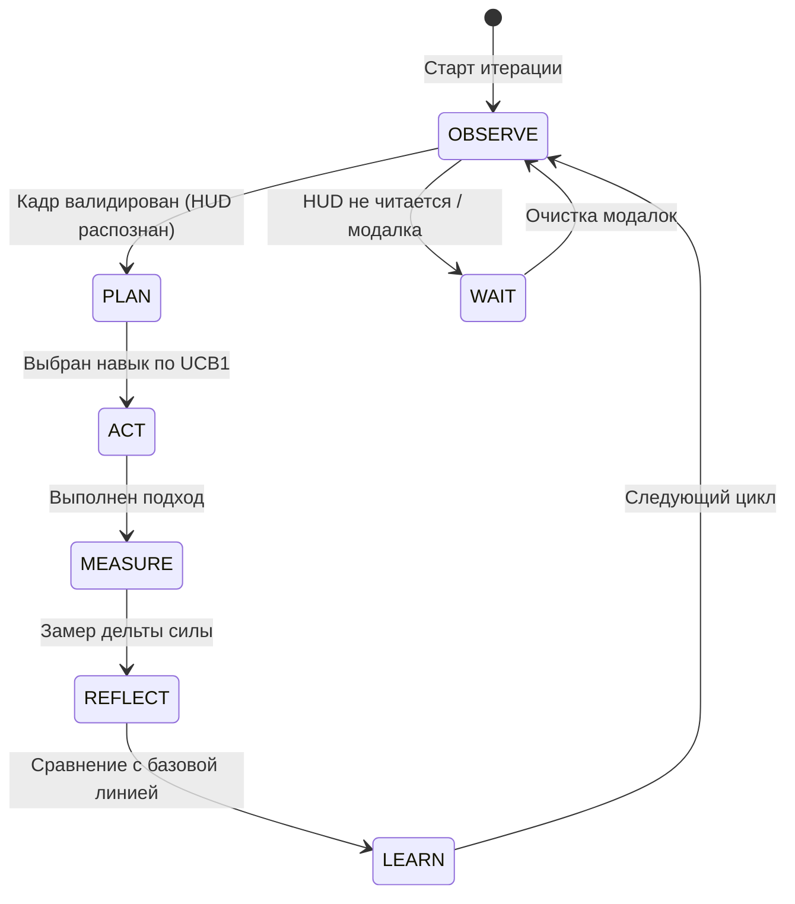

# 📐 Спецификация модели Alontito (Alontito Model Specification)

В данном документе приведено исчерпывающее техническое описание двух взаимосвязанных моделей, составляющих основу Alontito:
1. **Визуальная 3D-модель персонажа и анимационного движка (3D Character & Motion Model)**.
2. **Когнитивная модель саморазвивающегося агента (Cognitive & Self-Development Model)**.

---

## ЧАСТЬ I. 3D-МОДЕЛЬ ПЕРСОНАЖА И АНИМАЦИОННЫЙ ДВИЖОК

### 1. Геометрия, меш и материалы
* **Основной меш (`alontito/assets/3d/hooded_neon_character_rigged.glb`):**
  * **Формат:** binary glTF 2.0 (`.glb`).
  * **Размер:** 4,130,036 байт (~4.13 MB).
  * **Вершинная сетка:** Оптимизированная низкополигональная геометрия в стилистике чиби/аниме.
  * **Материалы (PBR):**
    * Тканевое матовое худи (`Roughness ~ 0.85`, `Metalness ~ 0.05`).
    * Неоновые светящиеся акценты и шнуры (`Emissive` текстуры, интенсивность свечения `1.2–1.5`).
    * Гладкая лицевая часть под капюшоном.

* **Вспомогательный меш портала (`alontito/assets/3d/mini_portal_slim.glb`):**
  * **Формат:** binary glTF 2.0 (`.glb`), 42,555,008 байт (~42.5 MB).
  * **Процедурный дублёр (Instant Procedural Fallback):** `THREE.TorusGeometry(0.24, 0.022, 16, 48)` с фиолетовым материалом `emissive: 0xa020f0` и радиальным градиентным спрайтом свечения 128×128. Позволяет отобразить рабочий портал мгновенно, пока тяжёлый `.glb` подгружается в фоновом потоке.

---

### 2. Скелет и кинематика (Skeleton Rigging)
Скелет построен по стандартной антропоморфной иерархии костей с нормализацией вращений в кватернионах:

```
Waist (Root Hip)
 ├── Spine01 (Нижняя часть позвоночника)
 │    └── Spine02 (Грудной отдел)
 │         └── Spine03 (Верхний отдел / Шея)
 │              └── Head (Голова с капюшоном)
 ├── R_Clavicle / L_Clavicle (Ключицы)
 │    └── R_UpperArm / L_UpperArm (Плечо)
 │         └── R_Forearm / L_Forearm (Предплечье)
 │              └── R_Hand / L_Hand (Кисть / Слот предметов)
 └── R_Thigh / L_Thigh (Бёдра)
      └── R_Calf / L_Calf (Голени)
           └── R_Foot / L_Foot (Ступни)
```

Каждая кость при интерполяции использует экспоненциальное сглаживание или гармонические колебания:
$$\theta(t) = A \cdot \sin(\omega t + \phi)$$

---

### 3. Реестр 34 анимаций и кинематические профили

Все анимации генерируются процедурно через `tools/build_pet_clips.py` с квантованием таймлайна (FPS 30) в `animations.json`:

1. **`idle`** (3.6 c, loop): базовое дыхание (`Spine01` $Z: -1.2^\circ \dots +0.2^\circ$), покачивание головы по $Y$ на $\pm 14^\circ$, мягкое вертикальное смещение бедер $Y \pm 0.004$ м.
2. **`walk`** (0.72 c, loop): цикл шага с противофазным махом рук и ног, вертикальное колебание таза $0.020 \cdot |\cos(w)| - 0.010$, наклон ключиц.
3. **`run`** (0.48 c, loop): динамичный бег с сильным наклоном корпуса вперёд ($Z: -14^\circ$), широким махом коленей и локтей.
4. **`tiptoe`** (1.1 c, loop): скрытное крадущееся передвижение с поднятыми ступнями и согнутыми коленями.
5. **`sit_idle`** (4.0 c, loop): положение сидя, согнутые колени ($Y: -0.225$ м), руки опираются на колени, расслабленное дыхание.
6. **`sit_down`** (0.8 c): переходное движение из стойки в положение сидя с глубоким приседом.
7. **`stand_up`** (0.8 c): подъем на ноги с выпрямлением коленей и восстановлением центра масс.
8. **`drag_panic`** (0.6 c, loop): состояние при перетаскивании мышью. Персонаж подвешен за капюшон, болтает ногами ($34^\circ \sin(fl)$) и судорожно машет руками во все стороны.
9. **`drag_drop`** (0.7 c): амортизация при отпускании мыши — сжатие пружины тела и выпрямление.
10. **`fall`** (0.5 c, loop): поза свободного падения с вытянутыми вверх руками и согнутыми коленями.
11. **`land`** (0.6 c): глубокое приседание при касании «пола» рабочего стола.
12. **`activity_coding`** (3.0 c, loop, prop: `laptop`): сидит с раскрытым ноутбуком, пальцы быстро барабанят по клавиатуре, наклон головы $Z: -16^\circ$.
13. **`activity_rubik`** (4.0 c, loop, prop: `rubik`): держит кубик Рубика перед собой, вращает грани, наклоняет голову для оценки собранных сторон.
14. **`roblox_watch_back`** (4.0 c, loop): разворот спиной к зрителю (facing $180^\circ$), покачивание головой влево-вправо, наблюдение за действиями в игре.
15. **`portal_reach_in`** (1.0 c): наклон в сторону портала ($-Z$), вытягивание левой руки в воронку.
16. **`portal_grab_item`** (0.6 c): захват предмета внутри портала.
17. **`portal_pull_out`** (0.8 c): извлечение предмета наружу с фиксацией в кисти.
18. **`item_consume`** (1.8 c): поднесение банки с энергетиком / пиццы / кофе ко рту, глоток, удовольствие.
19. **`item_stow`** (0.7 c): убирание остатка предмета или выбрасывание.
20. **`wave`** (1.6 c): дружеское приветствие правой рукой над головой.
21. **`clap`** (1.2 c, loop): радостные аплодисменты перед грудью.
22. **`point`** (1.4 c): указание указательным пальцем вперёд на окно или событие.
23. **`nod`** (1.0 c): двукратный утвердительный кивок головой.
24. **`shake_head`** (1.2 c): отрицательное покачивание головой.
25. **`shrug`** (1.8 c): удивлённое пожимание плечами с разведением рук в стороны.
26. **`dance`** (2.4 c, loop): ритмичный танец с переступанием ног и волнообразным движением рук.
27. **`happy`** (1.6 c): прыжок на месте с взмахом обеих рук вверх.
28. **`excited`** (1.0 c, loop): частое подпрыгивание от восторга с фиксацией взгляда.
29. **`laugh`** (1.8 c): смех с запрокидыванием головы назад и держанием за живот.
30. **`sad`** (2.4 c): опущенная голова, сгорбленные плечи, печальное вздыхание.
31. **`scared`** (1.2 c): вздрагивание, закрывание лица руками, отступление назад.
32. **`angry`** (1.6 c): топтание ногой, сжатые кулаки, сердитый наклон вперёд.
33. **`curious`** (2.0 c): наклон головы набок на $25^\circ$, приглядывание с приближением.
34. **`sleepy`** (3.0 c, loop): медленное клевание носом, опускание век и зевки.

---

### 4. Шейдеры и графические эффекты
* **Кастомный шейдер растворения (Dissolve Shader Chunk):**
  Инжектируется в `THREE.MeshStandardMaterial`:
  ```glsl
  uniform float uDissolve; // 0.0 = полностью виден, 1.0 = испарён
  uniform vec3 uEdgeColor; // #b070ff (неоново-фиолетовый)
  varying vec3 vWorldPos;

  // Функция 3D-шума Simplex Noise
  float n = snoise(vWorldPos * 8.0);
  if (n < uDissolve) discard;
  if (n < uDissolve + 0.05) {
      gl_FragColor = vec4(uEdgeColor * 2.5, 1.0); // Эмиссионный светящийся край
  }
  ```
* **Партикловая система:** Буферная геометрия `THREE.BufferGeometry` на 220 частиц. Каждая частица имеет атрибуты `position`, `aAge`, `aSize` с аддитивным смешиванием (`THREE.AdditiveBlending`).

---

## ЧАСТЬ II. КОГНИТИВНАЯ МОДЕЛЬ САМОРАЗВИТИЯ (AI COGNITIVE MODEL)

### 1. Архитектурный цикл агента (OODA-подобный контур)



---

### 2. Математическая модель бандита (UCB1 Exploration/Exploitation)

При выборе действия среди пула разрешённых навыков $K = \{ \text{Dumbbells}, \dots \}$ модуль `selfdev.py` вычисляет скор каждого действия:

$$\text{Score}(s) = \mu(s) \cdot P_{\text{success}}(s) + c \cdot \sqrt{\frac{\ln(N + 2)}{n(s) + 1}} \cdot \max(\mu(s), 1.0)$$

* $\mu(s)$ — математическое ожидание прироста целевой метрики в минуту ($\text{Strength / Min}$).
* $P_{\text{success}}(s) = \frac{\text{Successes}(s)}{\text{Attempts}(s)}$ — надёжность подтверждения.
* $N$ — суммарное число попыток по всем навыкам.
* $n(s)$ — число попыток текущего навыка.
* $c = 0.15$ — нормировочный коэффициент исследования.
* Для новых навыков без замеров ($n(s) = 0$) при флаге `include_untried=True` выставляется приоритетный скор для обязательного снятия начальной базовой линии.

---

### 3. Механизм самообучения и автоматического отката (Auto-Rollback)

В памяти `memory.json` в узле `"selfdev"` хранится состояние открытого эксперимента:
```json
{
  "active": {
    "id": 1795297200,
    "status": "active",
    "change": "faster click delay 0.05s",
    "metric": "strength_per_min",
    "rollback": "revert to 0.08s",
    "opened": "2026-11-22 00:38",
    "tries": 1,
    "last_verdict": ""
  },
  "params": {"action": "TRAIN_DUMBBELLS", "sets": 3, "reps": 20, "delay": 0.05},
  "prev_params": {"action": "TRAIN_DUMBBELLS", "sets": 3, "reps": 20, "delay": 0.08},
  "closed": [],
  "lessons": []
}
```

#### Правила перехода состояний:
1. **$\Delta \text{Ratio} > +10\%$ (`"лучше"`):**
   * Эксперимент помечается как `accepted`.
   * Текущие параметры `params` становятся новым эталоном (`prev_params = params`).
   * В реестр `lessons` заносится подтверждённая запись: `"оставить: <change> (<детали>)"`.
2. **$\Delta \text{Ratio} < -10\%$ (`"хуже"`):**
   * Эксперимент помечается как `rejected`.
   * Срабатывает `rollback_params()`: `params` немедленно восстанавливаются из `prev_params`.
   * В реестр заносится урок: `"откатить: <change> (<детали>)"`.
3. **$-10\% \le \Delta \text{Ratio} \le +10\%$ (`"без изменений"`):**
   * Первая попытка: эксперимент остаётся активным (`active`), бот собирает дополнительные замеры для отсечения шума.
   * Вторая попытка без изменений: эксперимент закрывается как `inconclusive` ("не меняет темп").

---

### 4. Компьютерное зрение и верификация (Ground Truth Vision)
* **Адаптивный порог Otsu:** вычисляется индивидуально по $L$-каналу цветового пространства HSL для жёлтых и синих бейджей.
* **Калибровка глифов (IoU Matching):**
  $$\text{IoU}(A, B) = \frac{|A \cap B|}{|A \cup B|}$$
  Матрицы 24×32 пикселя сравниваются с эталонами `glyph_templates.npz`. При совпадении $\text{IoU} \ge 0.82$ символ признаётся достоверным.
* **Защита от ложных срабатываний:** иконка гантели или кристаллов на плашке отсекается до классификации символов по геометрическому профилю ширины.

---

## 📌 Заключение

Представленная модель Alontito объединяет интерактивное 3D-присутствие на рабочем столе с математически строгим агентом обучения с подкреплением и компьютерным зрением. Каждое действие и графический элемент спроектированы для надёжной работы, минимального потребления системных ресурсов и гарантированной безопасности пользовательского окружения.
