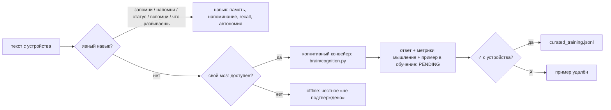

# 📐 Спецификация модели Alontito (Alontito Model Specification)

В данном документе приведено исчерпывающее техническое описание двух взаимосвязанных моделей, составляющих основу Alontito:
1. **Визуальная 3D-модель персонажа и анимационного движка (3D Character & Motion Model)**.
2. **Когнитивная модель саморазвивающегося агента (Cognitive & Self-Development Model)**.

---

## ЧАСТЬ I. 3D-МОДЕЛЬ ПЕРСОНАЖА И АНИМАЦИОННЫЙ ДВИЖОК

### 1. Геометрия, меш и материалы
* **Основной меш (`alontito/assets/3d/hooded_neon_character_rigged.glb`):**
  * **Формат:** binary glTF 2.0 (`.glb`).
  * **Размер:** 4,130,036 байт (~4.13 MB).
  * **Вершинная сетка:** Оптимизированная низкополигональная геометрия в стилистике чиби/аниме.
  * **Материалы (PBR):**
    * Тканевое матовое худи (`Roughness ~ 0.85`, `Metalness ~ 0.05`).
    * Неоновые светящиеся акценты и шнуры (`Emissive` текстуры, интенсивность свечения `1.2–1.5`).
    * Гладкая лицевая часть под капюшоном.

* **Вспомогательный меш портала (`alontito/assets/3d/mini_portal_slim.glb`):**
  * **Формат:** binary glTF 2.0 (`.glb`), 42,555,008 байт (~42.5 MB).
  * **Процедурный дублёр (Instant Procedural Fallback):** `THREE.TorusGeometry(0.24, 0.022, 16, 48)` с фиолетовым материалом `emissive: 0xa020f0` и радиальным градиентным спрайтом свечения 128×128. Позволяет отобразить рабочий портал мгновенно, пока тяжёлый `.glb` подгружается в фоновом потоке.

---

### 2. Скелет и кинематика (Skeleton Rigging)
Скелет построен по стандартной антропоморфной иерархии костей с нормализацией вращений в кватернионах:

```
Waist (Root Hip)
 ├── Spine01 (Нижняя часть позвоночника)
 │    └── Spine02 (Грудной отдел)
 │         └── Spine03 (Верхний отдел / Шея)
 │              └── Head (Голова с капюшоном)
 ├── R_Clavicle / L_Clavicle (Ключицы)
 │    └── R_UpperArm / L_UpperArm (Плечо)
 │         └── R_Forearm / L_Forearm (Предплечье)
 │              └── R_Hand / L_Hand (Кисть / Слот предметов)
 └── R_Thigh / L_Thigh (Бёдра)
      └── R_Calf / L_Calf (Голени)
           └── R_Foot / L_Foot (Ступни)
```

Каждая кость при интерполяции использует экспоненциальное сглаживание или гармонические колебания:
$$\theta(t) = A \cdot \sin(\omega t + \phi)$$

---

### 3. Реестр 49 анимаций и кинематические профили

Все анимации генерируются процедурно через `tools/build_pet_clips.py` (плюс v4-генератор) с квантованием таймлайна (FPS 30) в `animations.json`. Клип `roblox_watch_back` удалён вместе с игровым слоем (27.11.2026). Первые клипы:

1. **`idle`** (3.6 c, loop): базовое дыхание (`Spine01` $Z: -1.2^\circ \dots +0.2^\circ$), покачивание головы по $Y$ на $\pm 14^\circ$, мягкое вертикальное смещение бедер $Y \pm 0.004$ м.
2. **`walk`** (0.72 c, loop): цикл шага с противофазным махом рук и ног, вертикальное колебание таза $0.020 \cdot |\cos(w)| - 0.010$, наклон ключиц.
3. **`run`** (0.48 c, loop): динамичный бег с сильным наклоном корпуса вперёд ($Z: -14^\circ$), широким махом коленей и локтей.
4. **`tiptoe`** (1.1 c, loop): скрытное крадущееся передвижение с поднятыми ступнями и согнутыми коленями.
5. **`sit_idle`** (4.0 c, loop): положение сидя, согнутые колени ($Y: -0.225$ м), руки опираются на колени, расслабленное дыхание.
6. **`sit_down`** (0.8 c): переходное движение из стойки в положение сидя с глубоким приседом.
7. **`stand_up`** (0.8 c): подъем на ноги с выпрямлением коленей и восстановлением центра масс.
8. **`drag_panic`** (0.6 c, loop): состояние при перетаскивании мышью. Персонаж подвешен за капюшон, болтает ногами ($34^\circ \sin(fl)$) и судорожно машет руками во все стороны.
9. **`drag_drop`** (0.7 c): амортизация при отпускании мыши — сжатие пружины тела и выпрямление.
10. **`fall`** (0.5 c, loop): поза свободного падения с вытянутыми вверх руками и согнутыми коленями.
11. **`land`** (0.6 c): глубокое приседание при касании «пола» рабочего стола.
12. **`activity_coding`** (3.0 c, loop, prop: `laptop`): сидит с раскрытым ноутбуком, пальцы быстро барабанят по клавиатуре, наклон головы $Z: -16^\circ$.
13. **`activity_rubik`** (4.0 c, loop, prop: `rubik`): держит кубик Рубика перед собой, вращает грани, наклоняет голову для оценки собранных сторон.
14. **`roblox_watch_back`** (4.0 c, loop): разворот спиной к зрителю (facing $180^\circ$), покачивание головой влево-вправо, наблюдение за действиями в игре.
15. **`portal_reach_in`** (1.0 c): наклон в сторону портала ($-Z$), вытягивание левой руки в воронку.
16. **`portal_grab_item`** (0.6 c): захват предмета внутри портала.
17. **`portal_pull_out`** (0.8 c): извлечение предмета наружу с фиксацией в кисти.
18. **`item_consume`** (1.8 c): поднесение банки с энергетиком / пиццы / кофе ко рту, глоток, удовольствие.
19. **`item_stow`** (0.7 c): убирание остатка предмета или выбрасывание.
20. **`wave`** (1.6 c): дружеское приветствие правой рукой над головой.
21. **`clap`** (1.2 c, loop): радостные аплодисменты перед грудью.
22. **`point`** (1.4 c): указание указательным пальцем вперёд на окно или событие.
23. **`nod`** (1.0 c): двукратный утвердительный кивок головой.
24. **`shake_head`** (1.2 c): отрицательное покачивание головой.
25. **`shrug`** (1.8 c): удивлённое пожимание плечами с разведением рук в стороны.
26. **`dance`** (2.4 c, loop): ритмичный танец с переступанием ног и волнообразным движением рук.
27. **`happy`** (1.6 c): прыжок на месте с взмахом обеих рук вверх.
28. **`excited`** (1.0 c, loop): частое подпрыгивание от восторга с фиксацией взгляда.
29. **`laugh`** (1.8 c): смех с запрокидыванием головы назад и держанием за живот.
30. **`sad`** (2.4 c): опущенная голова, сгорбленные плечи, печальное вздыхание.
31. **`scared`** (1.2 c): вздрагивание, закрывание лица руками, отступление назад.
32. **`angry`** (1.6 c): топтание ногой, сжатые кулаки, сердитый наклон вперёд.
33. **`curious`** (2.0 c): наклон головы набок на $25^\circ$, приглядывание с приближением.
34. **`sleepy`** (3.0 c, loop): медленное клевание носом, опускание век и зевки.

---

### 4. Шейдеры и графические эффекты
* **Кастомный шейдер растворения (Dissolve Shader Chunk):**
  Инжектируется в `THREE.MeshStandardMaterial`:
  ```glsl
  uniform float uDissolve; // 0.0 = полностью виден, 1.0 = испарён
  uniform vec3 uEdgeColor; // #b070ff (неоново-фиолетовый)
  varying vec3 vWorldPos;

  // Функция 3D-шума Simplex Noise
  float n = snoise(vWorldPos * 8.0);
  if (n < uDissolve) discard;
  if (n < uDissolve + 0.05) {
      gl_FragColor = vec4(uEdgeColor * 2.5, 1.0); // Эмиссионный светящийся край
  }
  ```
* **Партикловая система:** Буферная геометрия `THREE.BufferGeometry` на 220 частиц. Каждая частица имеет атрибуты `position`, `aAge`, `aSize` с аддитивным смешиванием (`THREE.AdditiveBlending`).

---

## ЧАСТЬ II. МОДЕЛЬ АГЕНТА (с 27.11.2026)

Игровой контур OODA/UCB1 и компьютерное зрение HUD удалены вместе с игровым
слоем. С 28.11.2026 (E-025…E-028) у агента появился когнитивный конвейер v2
и автономный контур саморазвития: scaffold уровня передовых моделей вокруг
собственного мозга — преимущество не в весах, а в дисциплине мышления.

### 1. Маршрут одного сообщения (`alontito/agent.py`)



Навыки не требуют модели. Ответ мозга без модели не появляется: никакая
сторонняя модель не отвечает пользователю (решение 27.11.2026).

### 2. Когнитивный конвейер v2 (`brain/cognition.py`)

Скелет рассуждений вокруг собственного мозга (веса — свои, дисциплина —
инженерная):

| Этап | Что делает | Модель нужна? |
|---|---|---|
| Роутер усилий | `low / medium / high / max` — детерминированные эвристики (словарь + длина + «?»); max = «напиши модуль», «спроектируй», «найди причину» | нет |
| Декомпозиция | составной запрос режется на под-вопросы | нет |
| План + черновик | модель отвечает в формате `PLAN: … DRAFT: …`; пропущенные маркеры не ломают поток | да (1 вызов) |
| Критика | независимые раунды: `REVIEW: PASS / FIXED + FINAL:`; некорректный разбор никогда не затирает черновик | да (0–3 вызова) |
| Проверка опоры (grounding) | каждое число в ответе ищет источник: вопрос, факт из памяти, урок прошлого. Личный вопрос с неподтверждёнными числами получает пометку «⚠ не подтверждено» | нет |

Раунды критики: `high/max` — все (по умолчанию 2), `medium` — не больше
одного, `low` — ноль (малый разговор не должен ждать). Количество раундов —
параметр агента `review_rounds`, которым управляет автономия (см. §5).
Ответ несёт метаданные (`effort`, `rounds`, `grounding.confidence`) — по ним
саморазвитие измеряет качество мышления, а не угадывает.

### 3. Разъём мозга (`alontito/model.py`)

- `own` — свой локальный эндпоинт (формат Ollama `/api/chat` NDJSON или
  OpenAI-совместимый `/v1/chat/completions` SSE), стриминг в SSE-брокер;
  конфиг `config/alontito_brain.json` (в .gitignore), не-локальные адреса
  отклоняются до любого запроса.
- `teacher` — скачанная модель только для `tools/teacher_generate.py`;
  `ModelGateway.chat(role="teacher")` бросает `TeacherNotForRuntime` (тест).
- `offline` — ответы из реального статуса, без выдумок; в датасет не пишутся.
- Omni-лаборатория (`brain/opus_local_core.py`) — тренажёрная сторона:
  план → черновик → критика → ревизия для генерации обучающих данных.
  С 28.11.2026 работает на stdlib (urllib вместо requests), AST-страж
  канонический из `brain/skill_synthesis.py`, системный промпт приведён к
  пивоту (никаких игр и «эмуляции ввода»).

### 4. Автономия: саморазвитие по доказательствам (`brain/autonomy.py`)

Полная свобода агента в собственном развитии, ограниченная измерениями:

1. **Рутины** — агент сам держит своё расписание (консолидация памяти раз в
   `interval_min` минут), темп задаёт `ResourceGovernor` (токен-бакет).
2. **Метрики** — только реальные счётчики: `memory_health`
   (1 − противоречия/устаревшие против всех фактов), `helpfulness`
   (одобрено/всего примеров), `autonomy` (средний успех навыков),
   `punctuality` (повторяющиеся напоминания сработали вовремя). Нет данных —
   None, не ноль.
3. **Предложение** — ровно одно изменение за раз (гроссбух `selfdev`),
   выбранное по самому слабому измерению; у предложения есть метрика, иначе
   это не предложение. Изменение ПРИМЕНЯЕТСЯ (это и есть эксперимент).
4. **Вердикт** — не раньше полного интервала после открытия: до/после,
   полоса шума ±10%; «лучше» — параметр фиксируется уроком, «хуже» —
   `rollback_params`, два «без изменений» — закрыто без вывода.
   «Не смог измерить ≠ получилось» — правило E-001, действует дословно.

Цикл тикает раз в минуту в фоне сервера (`pult/server.py → background_tasks`),
события приходят уведомлениями на все устройства; в терминале — `/autonomy`.

### 5. Консолидация памяти (`brain/consolidation.py`)

Ночная (и плановая) уборка хранилища фактов по строгим правилам:

- **Дедуп** — близнецы сливаются (Жаккар ≥ 0.75 и совпадение цифр:
  «встреча в 15:00» и «в 16:00» никогда не сливаются), выживает самая
  ранняя копия с самым сильным статусом.
- **Противоречия** — тот же субъект, разное содержание → статус
  «ПРОТИВОРЕЧИЕ» обоим + открытый вопрос; ничего не удаляется.
- **Устаревание** — «СООБЩАЕТСЯ ВТОРИЧНЫМ»/«ГИПОТЕЗА» старше 60 дней без
  переподтверждения → «УСТАРЕВШИЕ».
- **Номинация** — измеримые гипотезы попадают в список кандидатов на
  продвижение; саму консолидацию промоушен не проводит никогда.

### 6. Синтез навыков (`brain/skill_synthesis.py`)

Агент пишет себе инструменты сам, под тремя независимыми воротами:

1. **AST-страж (белый список)** — импорты только из чистых модулей
   (`math, json, re, statistics, datetime, collections, itertools, string,
   random, decimal, fractions, typing, functools`); запрет `open, eval, exec,
   system, popen, input, remove, rmtree…`. Канонический страж, Omni-ядро
   импортирует его же.
2. **Автотест** — `run({})` обязан завершиться в таймаут-передержке и
   вернуть dict; зависший или падающий инструмент отклоняется, файл
   удаляется.
3. **Реестр с происхождением** — `tools/auto_generated/manifest.json`:
   задача, дата, факт теста. Вызов: `/autonomy synth <имя> <задача>`
   (нужен подключённый собственный мозг), откат — `SkillSynthesizer.remove`.

### 7. Контур обучения собственного мозга

Рантайм: ответ → `LearningEngine.add_example(approved=False)` → ✓ на
устройстве (`approve`) → `export_approved()` в `data/curated_training.jsonl`.
Учитель: темы из открытых вопросов и одобренных образцов тона; синтетика
тоже ждёт одобрения. Продвижение: `training/train_lora.py` (вручную, CUDA) →
`evaluation/regression_suite.py` → `compare_and_promote` (прирост ≥ 0.02 без
регрессии) → мозг включается как `own`.

### 8. Границы агента

Действия на ПК — только через `pc_actions` (выключено по умолчанию): белый
список действий, разрешённые корни папок, подтверждение с устройства.
Автономия свободна ТОЛЬКО внутри собственного домена агента: его рутины,
его параметры, его память, его навыки. Игровых действий не существует;
`ALLOWED_ACTIONS` пуст навсегда; облачных эндпоинтов не бывает.

---

## 📌 Заключение

Модель Alontito объединяет интерактивное 3D-присутствие на рабочем столе с
когнитивным конвейером вокруг собственного мозга: маршрутизация усилий,
декомпозиция, независимая критика, проверка опоры каждого числа против
памяти, автономное саморазвитие с вердиктом только по замерам, консолидация
памяти без переписывания истории и самосинтез навыков под тройным стражем.
Каждое действие и графический элемент спроектированы для надёжной работы,
минимального потребления ресурсов и гарантированной безопасности
пользовательского окружения.
