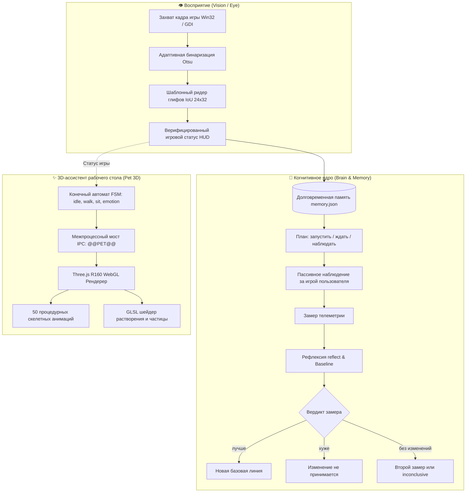

# 🤖 Alontito (Алонтито) — Open-Source AI Companion & 3D Desktop Assistant

> **Алонтито — наблюдательный компаньон, а не бот.**  
> Это открытый AI-ассистент для рабочего стола с интерактивным 3D-персонажем: он смотрит на игру пользователя через компьютерное зрение, измеряет и запоминает, подсказывает — и **никогда не играет за пользователя** (решение от 24.11.2026).

[](LICENSE)
[](https://www.python.org/)
[](https://threejs.org/)
[](tests/)

---

## 📌 Оглавление
1. [Архитектура модели](#-архитектура-модели)
2. [3D Модель персонажа и анимации](#-3d-модель-персонажа-и-анимации)
3. [Измерительная дисциплина](#-измерительная-дисциплина)
4. [Компьютерное зрение (Eye / Vision Model)](#-компьютерное-зрение-eye--vision-model)
5. [Гарантии безопасности (Safety Guardrails)](#-гарантии-безопасности-safety-guardrails)
6. [Установка и быстрый старт](#-установка-и-быстрый-старт)
7. [Команды терминала](#-команды-терминала)
8. [Веб-пульт](#-веб-пульт-pult)
9. [MCP-мост (Model Context Protocol)](#-mcp-мост-model-context-protocol)

---

## 🏛 Архитектура модели

Архитектура Alontito разделена на два синергичных ядра: **Когнитивное Ядро (Companion Core)** и **Визуальное Ядро (3D Desktop Companion)**.



Ввода в игру в этой схеме нет: от «Вердикта замера» нет стрелки обратно в игру.

---

## 🎭 3D Модель персонажа и анимации

### 1. 3D-меш и скелет (Rigging)
- **Файл модели:** `alontito/assets/3d/hooded_neon_character_rigged.glb` (4.13 MB).
- **Стилистика:** Киберпанк-персонаж в тёмном худи с неоновыми светящимися элементами, стилизованные аниме/чиби-пропорции.
- **Портал:** `alontito/assets/3d/mini_portal_slim.glb` (42.5 MB) с процедурным мгновенным неоновым тором в качестве fallback.
- **Иерархия костей (Skeleton Hierarchy):**
  - **Корневые кости:** `Waist`, `Spine01`, `Spine02`, `Spine03`, `Head`.
  - **Верхний пояс:** `R_Clavicle`, `R_UpperArm`, `R_Forearm`, `R_Hand`, `L_Clavicle`, `L_UpperArm`, `L_Forearm`, `L_Hand`.
  - **Нижний пояс:** `R_Thigh`, `R_Calf`, `R_Foot`, `L_Thigh`, `L_Calf`, `L_Foot`.
  - **Слоты предметов (Props):** `laptop` (ноутбук), `rubik` (кубик Рубика), `energy_can` (энергетик), `pizza`, `coffee`, `dumbbells`.

### 2. Библиотека анимаций (50 клипов)
Все клипы скомпилированы в `alontito/pet3d/animations.json`: 34 — генератором
`tools/build_pet_clips.py`, ещё 16 — `tools/build_pet_clips_v4.py` (обновление
v4/v5 от 24.11.2026). Имена ниже — это фактические ключи `animations.json`.

| Категория | Клипы | Описание механики |
| :--- | :--- | :--- |
| **Базовые движения** | `idle`, `walk`, `run`, `tiptoe`, `moonwalk`, `spin_360` | Дыхание, ходьба, спринт, передвижение на цыпочках, «лунная походка», оборот на 360° |
| **Сидячие позы** | `sit_idle`, `sleepy`, `think` | Посиделка, сонливость, поза раздумья |
| **Физика и реакция** | `drag_panic`, `drag_drop`, `fall`, `land`, `backflip`, `headbang` | Захват мышью за капюшон, свободное падение, приземление, сальто назад |
| **Деятельность** | `activity_coding`, `activity_rubik`, `roblox_watch_back`, `stretch`, `yawn` | Набор кода на ноутбуке, сборка кубика Рубика, поворот спиной к экрану для просмотра игры пользователя |
| **Портал и предметы** | `portal_reach_in`, `portal_eat_drink`, `peek` | Захват предмета из портала, «поедание», выглядывание из-за укрытия |
| **Жесты общения** | `wave`, `clap`, `point`, `nod`, `shake_head`, `shrug`, `bow`, `dab`, `idea` | Приветствие, аплодисменты, указание, кивок, отрицание головой, поклон, поза «есть идея» |
| **Эмоции** | `dance`, `happy`, `excited`, `laugh`, `sad`, `scared`, `angry`, `annoyed`, `confused`, `curious`, `shy`, `proud`, `facepalm`, `surprised`, `sneeze`, `cough` | Танец, восторг, смех, грусть, испуг, злость, смущение, чихание и кашель |
| **Служебные** | `disintegrate` | Шейдерное растворение при выключении |

### 3. Графический конвейер (Three.js WebGL Engine)
- **Кастомный шейдер растворения (Dissolve Shader):** плавное появление/исчезновение персонажа через 3D-шум с эмиссивной светящейся кромкой (`uDissolve`, `edge: 0xb070ff`).
- **Система частиц:** 220 аддитивных искр портала с интерполяцией цвета от бирюзового (`0x4cf0ff`) к фиолетовому (`0xc060ff`).
- **Адаптивный рендерер:**
  - `pixelRatio` ограничен до 1.5 (резкое снижение нагрузки на GPU и нагрева ноутбуков).
  - Спокойный режим: **20 FPS** (минимальное потребление CPU/GPU).
  - Активный режим (перетаскивание, портал, бег): **45 FPS** (высокая плавность).
  - Неблокирующий фоновый лоадер 42 МБ портала — окно питомца открывается за **1.5 секунды** без подвисаний.

---

## 📈 Измерительная дисциплина

Alontito не принимает догадки за улучшения. Всё, что он сообщает о игре, — это
либо число из замера, либо честное «не подтверждено»:

$$\text{Замер ДО} \longrightarrow \text{Событие} \longrightarrow \text{Замер ПОСЛЕ} \longrightarrow \text{Вердикт}$$

- **Полоса шума ($\pm 10\%$):** расхождение темпа внутри интервала считается статистической погрешностью HUD игры (`без изменений`).
- **Вердикт «лучше» ($> +10\%$):** новый темп становится базовой линией.
- **Вердикт «хуже» ($< -10\%$):** базовая линия не меняется.
- **Не смог измерить ≠ получилось:** подход или кадр без подтверждённого числа не засчитывается как успех.

**Библиотеки обучения из обновления v5** лежат в `brain/` и покрыты тестами:
`neuro_lab.py` (Thompson-бандит, любопытство, `ExperimentLab` — « baseline →
изменение → замер → вердикт» с откатом, память уроков), `task_planner.py`
(разбиение задачи на шаги с переиспользованием успешных уроков),
`resource_governor.py` (token-bucket и адаптивные интервалы), `panel_bridge.py`,
`voice_chat.py` (Vosk → Ollama → pyttsx3, всё офлайн). Они **не подключены** к
игровому циклу: Алонтито не действует, поэтому бандит и curriculum
(`skill_autonomy.py`) пока остаются библиотеками без потребителя. Описания и
причины правок — в `README_UPDATE.md` и `BUILDER_LOG.md` (E-022).

---

## 👁 Компьютерное зрение (Eye / Vision Model)

Alontito не внедряется в память процесса и не нарушает правила игры:
1. **Пассивный захват:** кадр окна Roblox читается с экрана; окно не поднимается, не разворачивается и не перетаскивается. Если игра закрыта другим окном — Алонтито честно пишет «это не кадр игры».
2. **DPI-Aware Capture:** учет масштабирования экрана Windows (125%, 150%, 175%) с калибровкой системных координат через `SetProcessDpiAwarenessContext(-2)`.
3. **Шаблонный матчинг глифов:** цифры HUD Muscle Legends читаются специализированным ридером по матрицам символов 24×32 с IoU-скорингом (исключает галлюцинации нейросетевого OCR вроде превращения `100K` в кириллицу).
4. **Мульти-кадровая верификация:** факт прироста силы засчитывается только тогда, когда показания до и после подтверждены двумя независимыми кадрами.
5. **Калибровка без правки кода:** скопируйте `config_rois.json.example` в `config_rois.json` или задайте файл в `ALONTITO_ROIS` — области HUD подстроятся под ваше разрешение.

---

## 🛡 Гарантии безопасности (Safety Guardrails)

В код архитектурно зашиты непреодолимые ограничения:

- ❌ **Алонтито не играет за пользователя (24.11.2026).** `config.GAME_INPUT_ENABLED = False`:
  `InputController` отклоняет каждую клавишу, кнопку мыши и движение курсора в
  единственной точке, где они доходят до Windows. Ни команда терминала, ни
  веб-пульт, ни голос, ни MCP-клиент не могут отправить ввод в игру.
- ❌ **Никаких реальных денег и Robux:** нет кода для взаимодействия с биллингом или покупок за реальную валюту.
- ❌ **Никаких инъекций DLL / Lua:** никаких эксплойтов (Synapse, Electron и т.д.); только внешний захват экрана.
- ❌ **Никаких трейдов:** агент не принимает и не отправляет обмены.
- ❌ **Никакого вывода за пределы машины:** только локальный Ollama `http://127.0.0.1:11434`; облачное распознавание речи из обновления удалено.

---

## 🚀 Установка и быстрый старт

### Требования
- **ОС:** Windows 10 / 11 (64-bit) — драйверы захвата экрана используют Win32 API; когнитивное ядро, память, пульт и MCP переносятся на другие ОС (`core/platform.py`).
- **Python:** 3.10 — 3.13 (64-bit)

### Установка зависимостей
```bash
pip install PyQt6 PyQt6-WebEngine pillow numpy opencv-python mss
```

### Запуск
```bash
# Терминал Алонтито (главный вход):
Alontito.bat            # или python alontito.py

# Пассивное наблюдение без терминала (журнал сцены):
python main.py          # то же, что python main.py --watch
python main.py --monitor

# Веб-пульт в браузере:
Pult.bat                # или python pult/server.py
```

Запустить отдельно 3D-питомца на рабочий стол:
```bash
python alontito/desktop_pet.py --standalone
```

---

## ⌨ Команды терминала

Внутри интерфейса Alontito доступны команды (22 команды; `/train` больше нет):

| Команда | Описание |
| :--- | :--- |
| `/auto` | Автопоиск запущенного клиента Roblox и подключение к игре |
| `/play` | Запуск игры по каталогу (Muscle Legends place id `3623096087`) — для пользователя, по официальной ссылке |
| `/watch [сек]` | Наблюдение без действий: чтение HUD и замер темпа силы за N секунд |
| `/status` | Моментальный аудит текущего состояния игры и персонажа |
| `/attach` | Доказать, что в текущем кадре виден HUD игры |
| `/learn` | Что известно из замеров: прогоны, средний темп, уроки |
| `/3d [on/off/scale]` | Управление 3D-питомцем (включение, выключение, масштабирование 0.4–2.5) |
| `/omni` | Отчёт по подсистеме непрерывного обучения: ядро, память опыта, Ollama, обучение (только чтение) |
| `/memory` | Просмотр базы знаний, фактов и разрешённых противоречий |
| `/skills`, `/journal` | Навыки с замерами и журнал событий |
| `/safety` | Отчёт о правилах безопасности и заблокированных действиях |
| `/mcp` | Запуск сервера протокола контекста модели (MCP) |
| `/games`, `/info`, `/about`, `/github`, `/support`, `/home`, `/theme`, `/quit` | Каталог игр, справка, ссылки, навигация |

---

## 🖥 Веб-пульт (Pult)

`pult/server.py` — пульт без единой pip-зависимости: панель, чат (Ollama),
живой терминал, память и база знаний. Доступен с ПК; для телефона локальную
сеть открывают явно (`"host": "0.0.0.0"` в `pult/pult_config.json`).

- По умолчанию слушает только `127.0.0.1`: пульт показывает кадр экрана и историю чата.
- Токен генерируется при первом запуске, хранится в `pult/pult_config.json` (файл в `.gitignore`).
- Единственные действия — «Проверка HUD» и «Наблюдать сцену». Эндпоинта команд агенту нет.

Подробности: `pult/docs/PULT_README.md`.

---

## 🔌 MCP-мост (Model Context Protocol)

Alontito поддерживает стандарт **Model Context Protocol (MCP)**, позволяя внешним AI-агентам (Claude Desktop, Cursor, Antigravity, Gemini) считывать состояние игры и память компаньона:
```bash
python -m alontito.mcp_server
```
Доступные MCP-инструменты (только чтение и запись факта в память):
`get_game_vision_state`, `capture_screenshot_base64`, `get_bot_memory`,
`record_learned_fact`. Инструмент выполнения действий в игре удалён; запрос
`execute_safe_action` получает честный отказ.

---

## 🧠 Omni: непрерывное обучение (локально)

Подсистема **Omni** превращает наблюдения в опыт и проверяет улучшения, не подменяя измерения обещаниями:

- **Память опыта** — SQLite `data/alontito_memory.sqlite3`: 64-битный перцептивный хеш кадра, распознанный текст, координаты, метрики, окна. Сами скриншоты в базу не пишутся.
- **Обучение с порогом доказательств** — `data/alontito_learning.sqlite3`: пример попадает в `data/curated_training.jsonl` только при `approved=1` (явное одобрение человеком или объективный замер). Модель не может одобрить сама себя.
- **UCB1-исследователь** — 5 разрешённых действий, полоса шума ±10%, откат при ухудшении, два согласованных замера HUD перед вердиктом.
- **Регрессия и промоушен** — контрактный набор `evaluation/regression_suite.py`; кандидат повышается только при приросте ≥ 0.02 и без регрессии.
- **Дашборд** — `http://127.0.0.1:8080` при отдельном запуске; **Telegram** и **голос** — опционально; **LoRA** — только вручную и только при наличии CUDA.

Запуск отдельно (не из терминала):

```bash
pip install -r requirements_omni.txt
Alontito_Omni.bat
```

Нужны локальные модели Ollama из `config_omni.json` (`alontito-opus:latest`, `deepseek-r1:14b`, `qwen2.5:7b-instruct`, `qwen2.5vl:7b`). Платных API нет — всё считается на вашей машине.

`/omni` в терминале работает **только на чтение**: показывает, что реально установлено и запущено, и ничего не запускает. Исполнитель ввода у исследователя по умолчанию не подключён (dry-run), а сам ввод в игру отключён на уровне `InputController`.

Слово «Opus» в именах файлов — обозначение цикла «план → независимая критика → правка», а не заявление о весах модели. Проверка моделью не заменяет независимый факт-чек.

---

## 🧪 Тестирование

Проект покрыт модульными и интеграционными тестами (логика питомца, зрение,
безопасность, память Omni, запрет ввода, веб-пульт, библиотеки v5):

```bash
python -m unittest tests.test_alontito tests.test_verification tests.test_eye tests.test_pet_logic tests.test_omni_link tests.test_experience_memory tests.test_learning_engine tests.test_omni_opus5 tests.test_neuro_lab tests.test_skill_autonomy tests.test_task_planner tests.test_resource_governor tests.test_panel_bridge tests.test_voice_chat tests.test_input_guard tests.test_pult tests.test_watcher_passive
```

На 27.11.2026 — **266 тестов**, результат `OK`. Не заменяйте эту команду на
`unittest discover`: в проекте есть тесты, которые меняют рабочие файлы и
требуют изоляции.

---

## 📄 Лицензия
Проект распространяется под открытой лицензией **MIT License**. Разработано командой Alontito Dev Team.
