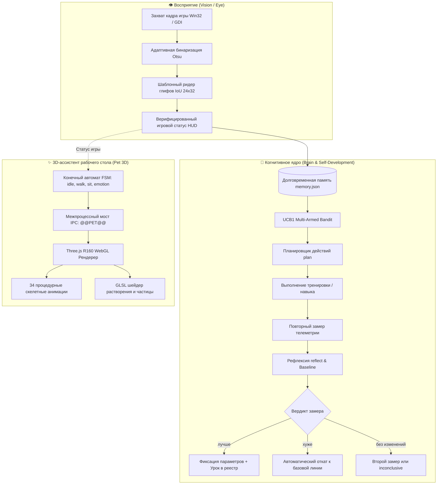

# 🤖 Alontito (Алонтито) — Open-Source AI Agent & 3D Desktop Companion

> **Алонтито — это больше, чем бот.**  
> Это открытый автономный саморазвивающийся игровой AI-агент и интерактивный 3D-ассистент на рабочем столе, спроектированный для честной игры, визуального восприятия через компьютерное зрение и непрерывного обучения на основе строгих замеров.

[](LICENSE)
[](https://www.python.org/)
[](https://threejs.org/)
[](tests/)

---

## 📌 Оглавление
1. [Архитектура модели](#-архитектура-модели)
2. [3D Модель персонажа и анимации](#-3d-модель-персонажа-и-анимации)
3. [Интеллектуальная модель и саморазвитие (UCB1)](#-интеллектуальная-модель-и-саморазвитие-ucb1)
4. [Компьютерное зрение (Eye / Vision Model)](#-компьютерное-зрение-eye--vision-model)
5. [Гарантии безопасности (Safety Guardrails)](#-гарантии-безопасности-safety-guardrails)
6. [Установка и быстрый старт](#-установка-и-быстрый-старт)
7. [Команды терминала](#-команды-терминала)
8. [MCP-мост (Model Context Protocol)](#-mcp-мост-model-context-protocol)

---

## 🏛 Архитектура модели

Архитектура Alontito разделена на два синергичных ядра: **Когнитивное Ядро (AI Agent Core)** и **Визуальное Ядро (3D Desktop Companion)**.



---

## 🎭 3D Модель персонажа и анимации

### 1. 3D-меш и скелет (Rigging)
- **Файл модели:** `alontito/assets/3d/hooded_neon_character_rigged.glb` (4.13 MB).
- **Стилистика:** Киберпанк-персонаж в тёмном худи с неоновыми светящимися элементами, стилизованные аниме/чиби-пропорции.
- **Портал:** `alontito/assets/3d/mini_portal_slim.glb` (42.5 MB) с процедурным мгновенным неоновым тором в качестве fallback.
- **Иерархия костей (Skeleton Hierarchy):**
  - **Корневые кости:** `Waist`, `Spine01`, `Spine02`, `Spine03`, `Head`.
  - **Верхний пояс:** `R_Clavicle`, `R_UpperArm`, `R_Forearm`, `R_Hand`, `L_Clavicle`, `L_UpperArm`, `L_Forearm`, `L_Hand`.
  - **Нижний пояс:** `R_Thigh`, `R_Calf`, `R_Foot`, `L_Thigh`, `L_Calf`, `L_Foot`.
  - **Слоты предметов (Props):** `laptop` (ноутбук), `rubik` (кубик Рубика), `energy_can` (энергетик), `pizza`, `coffee`, `dumbbells`.

### 2. Библиотека анимаций (34 клипа)
Все клипы скомпилированы в `alontito/pet3d/animations.json` процедурным генератором `tools/build_pet_clips.py`:

| Категория | Клипы | Описание механики |
| :--- | :--- | :--- |
| **Базовые движения** | `idle`, `walk`, `run`, `tiptoe` | Дыхание, покачивание головы, ходьба, спринт на дистанции и скрытное передвижение на цыпочках |
| **Сидячие позы** | `sit_idle`, `sit_down`, `stand_up` | Переход в положение сидя, покачивание коленями, подъём на ноги |
| **Физика и реакция** | `drag_panic`, `drag_drop`, `fall`, `land` | Захват мышью за капюшон (болтание ногами), свободное падение и упругое приземление с амортизацией |
| **Деятельность** | `activity_coding`, `activity_rubik`, `roblox_watch_back` | Набор кода на ноутбуке, сборка кубика Рубика, поворот спиной к экрану для просмотра игры пользователя |
| **Портал и предметы** | `portal_reach_in`, `portal_grab_item`, `portal_pull_out`, `item_consume`, `item_stow` | Открытие портала, затягивание руки в портал, извлечение предмета, поглощение/еда и закрытие |
| **Жесты общения** | `wave`, `clap`, `point`, `nod`, `shake_head`, `shrug` | Приветствие рукой, аплодисменты, указание пальцем, кивок одобрения, отрицание головой, пожимание плечами |
| **Эмоции** | `dance`, `happy`, `excited`, `laugh`, `sad`, `scared`, `angry`, `curious`, `sleepy` | Праздничный танец, восторг, смех, грусть, испуг, злость, любопытство с наклоном головы, сонливость |

### 3. Графический конвейер (Three.js WebGL Engine)
- **Кастомный шейдер растворения (Dissolve Shader):** плавное появление/исчезновение персонажа через 3D-шум с эмиссионной светящейся кромкой (`uDissolve`, `edge: 0xb070ff`).
- **Система частиц:** 220 аддитивных искр портала с интерполяцией цвета от бирюзового (`0x4cf0ff`) к фиолетовому (`0xc060ff`).
- **Адаптивный рендерер:**
  - `pixelRatio` ограничен до 1.5 (резкое снижение нагрузки на GPU и нагрева ноутбуков).
  - Спокойный режим: **20 FPS** (минимальное потребление CPU/GPU).
  - Активный режим (перетаскивание, портал, бег): **45 FPS** (высокая плавность).
  - Неблокирующий фоновый лоадер 42 МБ портала — окно питомца открывается за **1.5 секунды** без подвисаний.

---

## 📈 Интеллектуальная модель и саморазвитие (UCB1)

Alontito не использует слепые эвристики и не принимает случайные догадки за улучшения. Основа его интеллекта — строгий научный цикл:

$$\text{Гипотеза} \longrightarrow \text{Замер ДО} \longrightarrow \text{Изменение} \longrightarrow \text{Замер ПОСЛЕ} \longrightarrow \text{Рефлексия}$$

### 1. Алгоритм выбора действий (UCB1 Multi-Armed Bandit)
Ранжирование доступных тренировочных действий производится по формуле:

$$\text{Score} = \text{Exploit} \times \text{SuccessRate} + \text{Explore} \times \max(\text{Exploit}, 1.0) \times 0.15$$

где:
- $\text{Exploit} = \frac{\Delta \text{Strength}}{\text{Seconds}} \times 60$ — чистый темп прироста силы в минуту.
- $\text{Explore} = \sqrt{\frac{\ln(\text{TotalAttempts} + 2)}{\text{Attempts} + 1}}$ — штраф за неопределённость, стимулирующий исследование менее протестированных действий.

### 2. Защита от деградации (Automatic Rollback)
- **Полоса шума ($\pm 10\%$):** замеры внутри интервала $\pm 10\%$ считаются статистической погрешностью HUD игры (`без изменений`).
- **Вердикт «лучше» ($> +10\%$):** изменение закрепляется, параметры фиксируются как новый эталон, урок заносится в долговременную память.
- **Вердикт «хуже» ($< -10\%$):** изменение немедленно отвергается, вызывается `rollback_params()`, параметры откатываются к предшествующему стабильному состоянию.

---

## 👁 Компьютерное зрение (Eye / Vision Model)

В отличие от традиционных ботов, Alontito не внедряется в память процесса и не нарушает правила игры:
1. **DPI-Aware Capture:** учет масштабирования экрана Windows (125%, 150%, 175%) с калибровкой системных координат через `SetProcessDpiAwarenessContext(-2)`.
2. **Шаблонный матчинг глифов:** цифры HUD Muscle Legends читаются специализированным ридером по матрицам символов 24×32 с IoU-скорингом (исключает галлюцинации нейросетевого OCR вроде превращения `100K` в кириллицу).
3. **Мульти-кадровая верификация:** факт прироста силы засчитывается только тогда, когда показания до и после подтверждены двумя независимыми кадрами.

---

## 🛡 Гарантии безопасности (Safety Guardrails)

В код архитектурно зашиты непреодолимые ограничения:
- ❌ **Никаких реальных денег и Robux:** бот не имеет кода для взаимодействия с биллингом или покупок за реальную валюту.
- ❌ **Никаких инъекций DLL / Lua:** бот не использует эксплойты (Synapse, Electron и т.д.), работая исключительно как внешний наблюдатель (клавиатура/мышь).
- ❌ **Никаких трейдов:** все входящие предложения обмена отклоняются автоматически.
- ❌ **Белый список действий (`ALLOWED_ACTIONS`):** разрешены исключительно безопасные спортивные упражнения и закрытие модальных окон.

---

## 🚀 Установка и быстрый старт

### Требования
- **ОС:** Windows 10 / 11 (64-bit)
- **Python:** 3.10 — 3.13 (64-bit)

### Установка зависимостей
```bash
pip install PyQt6 PyQt6-WebEngine pillow numpy opencv-python mss
```

### Запуск приложения
Запустить интерактивную консоль Alontito с автоматическим предложением запуска 3D-ассистента:
```bash
# Через батник:
Alontito.bat

# Или напрямую через Python:
python main.py
```

Запустить отдельно 3D-питомца на рабочий стол:
```bash
python alontito/desktop_pet.py
```

---

## ⌨ Команды терминала

Внутри интерфейса Alontito доступны команды:

| Команда | Описание |
| :--- | :--- |
| `/auto` | Автопоиск запущенного клиента Roblox и подключение к игре |
| `/play` | Запуск игры по каталогу (Muscle Legends place id `3623096087`) |
| `/train [N]` | Выполнить $N$ подтверждённых подходов с замером темпа и рефлексией |
| `/watch` | Режим наблюдателя: анализ HUD, проверка модалок и бейджей силы |
| `/learn` | **Панель саморазвития:** статус открытого эксперимента, UCB-рейтинг и реестр уроков |
| `/status` | Моментальный аудит текущего состояния игры и персонажа |
| `/3d [on/off/scale]` | Управление 3D-питомцем (включение, выключение, масштабирование 0.4–2.5) |
| `/memory` | Просмотр базы знаний, фактов и разрешённых противоречий |
| `/safety` | Отчёт о правилах безопасности и заблокированных действиях |
| `/mcp` | Запуск сервера протокола контекста модели (MCP) |
| `/quit` | Корректный выход с сохранением состояния |

---

## 🔌 MCP-мост (Model Context Protocol)

Alontito поддерживает стандарт **Model Context Protocol (MCP)**, позволяя внешним AI-агентам (Claude Desktop, Cursor, Antigravity, Gemini) управлять ботом и считывать телеметрию:
```bash
python -m alontito.mcp_server
```
Доступные MCP-инструменты: `alontito_status`, `alontito_observe`, `alontito_train`, `alontito_propose`, `alontito_reflect`.

---

## 🧪 Тестирование

Проект покрыт всесторонними модульными и интеграционными тестами (логика питомца, математика UCB, зрение, безопасность):
```bash
python -m unittest discover -s tests
```
Все **140 тестов** выполняются с результатом `OK`.

---

## 📄 Лицензия
Проект распространяется под открытой лицензией **MIT License**. Разработано командой Alontito Dev Team.
